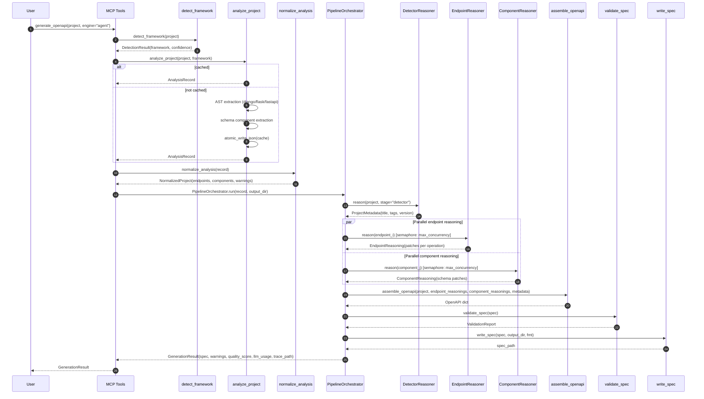
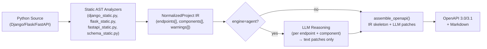

# pyopenapi

**An MCP server that turns Python web-framework source code into OpenAPI 3.0/3.1 specifications and Markdown documentation.**

Designed for coding agents (OpenCode, Claude Code, Cursor, etc.) and CI pipelines. Runs locally over stdio or as a shared HTTP service with auth, rate-limiting, and operational endpoints.

---

## Architecture Overview

```mermaid
flowchart TD
    %% USER INPUT
    User["User / Agent\n(project_path or GitHub URL)"] -->|MCP tools.call| MCPServer

    %% MCP SERVER ENTRY
    subgraph MCP["pyopenapi MCP Server (stdio / streamable-http)"]
        direction TB
        MCPServer["FastMCP Instance\nserver/instance.py"]
        Tools["MCP Tools\nserver/tools.py"]
        Resources["MCP Resources\nserver/resources.py"]
        HttpGuard["HttpGuardMiddleware\nserver/http.py"]
    end

    %% TOOL DISPATCH
    MCPServer -->|route| Tools
    Tools -->|1. detect_framework| DetectFramework
    Tools -->|2. analyze_project| AnalyzeProject
    Tools -->|3. generate_openapi| GenerateOpenAPI
    Tools -->|4. generate_markdown| GenerateMarkdown
    Tools -->|5. generate_docs| GenerateDocs
    Tools -->|6. validate_openapi| ValidateOpenAPI
    Tools -->|7. merge_specs| MergeSpecs
    Tools -->|8. diff_specs| DiffSpecs
    Tools -->|8. analyze_workspace| AnalyzeWorkspace

    %% LEVEL 1 — FRAMEWORK DETECTION
    subgraph L1["Level 1 — Framework Detection"]
        DetectFramework["detect_framework(project_path)"]
        ResolveSource1["resolve_project_source()\n→ local path OR GitHub clone"]
        Detection["detection.detect_framework()\n• weighted signals (imports, decorators, patterns)\n• Django / Flask / FastAPI / unknown"]
    end

    DetectFramework --> ResolveSource1
    ResolveSource1 --> Detection
    Detection -->|DetectionResult| DetectFramework

    %% LEVEL 2 — PROJECT ANALYSIS (CACHED)
    subgraph L2["Level 2 — Project Analysis (cached)"]
        AnalyzeProject["analyze_project(project_path, framework, …)"]
        ResolveSource2["resolve_project_source()\n• GitHub → shallow clone (dulwich) into cache/repos/\n• local → resolve_project_path()"]
        CacheKey["cache key = short_hash(resolved_path, framework, options)"]
        CacheHit{"cached?"}
        Manager["AnalysisManager.analyze()\ncore/analysis.py"]
        AnalyzerDispatch{"framework?"}
        DjangoAnalyzer["analyzers/django_static.py\n• AST + optional dynamic URLconf\n• DRF ViewSets, @action, @api_view\n• serializers → components"]
        FlaskAnalyzer["analyzers/flask_static.py\n• two-pass:\n  1. collect apps/blueprints/registrations globally\n  2. resolve decorators via imports\n• @app.route, @bp.route, add_url_rule, add_resource"]
        FastAPIAnalyzer["analyzers/fastapi_static.py\n• AST extraction\n• @app.get/@router.get, APIRouter\n• path/query params, Pydantic models"]
        SchemaAnalyzer["analyzers/schema_static.py\n• Pydantic / Marshmallow / Enum components"]
        DjangoComponents["analyzers/django_components_static.py\n• ModelSerializer → model fields\n• Meta.model / Meta.fields expansion\n• infers id/*_id as integer read-only"]
        RawAnalysis["RawAnalysis\n• endpoints[]\n• components{}\n• warnings[]\n• metadata"]
        Persist["atomic_write_json()\nanalysis.json / endpoints.json / components.json / metadata.json"]
        LoadCache["load cached AnalysisRecord"]
    end

    AnalyzeProject --> ResolveSource2
    ResolveSource2 --> CacheKey
    CacheKey --> CacheHit
    CacheHit -->|yes| LoadCache
    CacheHit -->|no| Manager
    Manager --> AnalyzerDispatch
    AnalyzerDispatch -->|django| DjangoAnalyzer
    AnalyzerDispatch -->|flask| FlaskAnalyzer
    AnalyzerDispatch -->|fastapi| FastAPIAnalyzer
    DjangoAnalyzer --> SchemaAnalyzer
    FlaskAnalyzer --> SchemaAnalyzer
    FastAPIAnalyzer --> SchemaAnalyzer
    DjangoAnalyzer --> DjangoComponents
    SchemaAnalyzer --> RawAnalysis
    DjangoComponents --> RawAnalysis
    RawAnalysis --> Persist
    Persist -->|AnalysisRecord| AnalyzeProject
    LoadCache -->|AnalysisRecord| AnalyzeProject

    %% LEVEL 3 — OPENAPI SPEC GENERATION
    subgraph L3["Level 3 — OpenAPI Spec Generation"]
        GenerateOpenAPI["generate_openapi(analysis_id | project_path, engine, fmt)"]
        ResolveRecord["_resolve_record()\n→ AnalysisRecord"]
        IRNormalizer["normalize_analysis()\ncore/ir/normalizer.py\n• groups operations by path\n• dedupes parameters\n• infers request/response models\n• produces NormalizedProject"]
        EngineChoice{"engine?"}
        AgentEngine["engine=agent|auto with provider\n→ PipelineOrchestrator\nIR → per-endpoint/component reasoning → assembly\n(auto without provider → static spec + warning)"]
        StaticEngine["engine=static → deterministic AST extraction\npaths, params, types, $refs, required flags"]
        SinglePassEngine["engine=nvidia|openrouter|lmstudio|…\n→ enrich_openapi_with_llm()\nlegacy single-pass enrichment"]
        LLMEngine["engine=llm (Django only)\n→ upstream knowl-apidocs pipeline"]
        Provider["resolve_provider()\n• auto: NVIDIA_API_KEY → nvidia\n          OLLAMA_HOST → ollama\n• explicit: PYOPENAPI_LLM_PROVIDER"]
        LLMClient["httpx.AsyncClient → /chat/completions\n• chunk endpoints (llm_endpoints_per_request)\n• semaphore (llm_max_concurrency)\n• model auto-discovery via /models"]
        Assembler["assemble_openapi()\ncore/assembler.py\n• applies EndpointReasoning / ComponentReasoning patches\n• deterministic IR skeleton + LLM text patches\n• validation"]
        WriteSpec["write_spec(spec, out_dir, fmt)\n• fmt=yml → openapi.yml\n• fmt=yaml → openapi.yaml\n• fmt=json → openapi.json"]
    end

    GenerateOpenAPI --> ResolveRecord
    ResolveRecord --> IRNormalizer
    IRNormalizer --> EngineChoice
    EngineChoice -->|agent| AgentEngine
    EngineChoice -->|static| StaticEngine
    EngineChoice -->|llm| SinglePassEngine
    EngineChoice -->|provider| SinglePassEngine
    SinglePassEngine --> Provider
    Provider --> LLMClient
    LLMClient --> Assembler
    StaticEngine --> WriteSpec
    AgentEngine --> Assembler
    Assembler --> WriteSpec
    WriteSpec -->|GenerationResult| GenerateOpenAPI

    %% LEVEL 4 — MARKDOWN DOCUMENTATION
    subgraph L4["Level 4 — Markdown Generation"]
        GenerateMarkdown["generate_markdown(analysis_id | spec_path | openapi, layout)"]
        LoadSpec["load_spec()\n→ OpenAPI dict"]
        MarkdownGen["generate_markdown()\ncore/markdown.py\n• layout=multi → index.md + endpoints/ + components/\n• layout=single → api.md\n• tables for params, request/response, schemas"]
        WriteMD["atomic_write_text()\n→ output_dir/"]
    end

    GenerateMarkdown --> LoadSpec
    LoadSpec --> MarkdownGen
    MarkdownGen --> WriteMD

    %% MERGE / DIFF
    subgraph LD["Level 3b — Spec Merge & Diff"]
        MergeSpecs["merge_specs(specs[], on_conflict)\n• union paths, dedupe by method+path\n• merge components by name\n• x-pyopenapi-warnings for skipped dupes\n• on_conflict: first|warn|error"]
        DiffSpecs["diff_specs(old, new)\n• classifies breaking vs additive:\n  - removed endpoint/method = breaking\n  - removed schema property = breaking\n  - new required field = breaking\n  - added endpoint/property = non-breaking"]
    end

    Tools --> MergeSpecs
    Tools --> DiffSpecs

    %% DASHBOARD / TRACES / QUALITY
    subgraph LOBS["Observability"]
        Dashboard["pyopenapi dashboard <output_dir>\n• live progress via agent_progress.jsonl\n• quality score, LLM usage, stage timings"]
        Traces["pyopenapi traces <source>\n• agent_trace.json: prompts, responses, tokens"]
        Quality["pyopenapi quality <source>\n• deterministic findings (missing descriptions,\n  unused components, etc.)"]
        Progress["pyopenapi progress <source>\n• stage events: run_start, item_done, stage_end"]
    end

    Tools --> Dashboard
    Tools --> Traces
    Tools --> Quality
    Tools --> Progress

    %% CACHE / WORKSPACE
    subgraph LWS["Cache & Workspace"]
        CacheStats["cache_stats\n• total analyses, bytes, oldest/newest"]
        CleanupCache["cleanup_cache(dry_run, max_age, max_bytes)\n• prunes stale analyses"]
        AnalyzeWorkspace["analyze_workspace(dir, merge)\n• scans subdirs, analyzes each\n• optional merged spec"]
    end

    Tools --> CacheStats
    Tools --> CleanupCache
    Tools --> AnalyzeWorkspace
```



---

## Data Flow: Agent Pipeline (Detailed)



---

## Supported Frameworks

| Framework             | Status | Endpoints                      | Schema Components            | Agent Pipeline | Explicit Static |
| --------------------- | ------ | ------------------------------ | ---------------------------- | -------------- | --------------- |
| Django / DRF          | stable | AST + optional runtime URLconf | serializers, models, enums   | yes            | yes             |
| Flask / Flask-RESTful | stable | static AST                     | Pydantic, Marshmallow, enums | yes            | yes             |
| FastAPI               | stable | static AST                     | Pydantic, enums              | yes            | yes             |

---

## How It Works: Static Analysis → Agent Enrichment

**Key principle: Source code never leaves your machine.**

1. **Static analysis (local AST)** extracts structural evidence:

   - All declared routes/decorators (`@app.get`, `@router.post`, `@action`, `@api_view`)
   - Type annotations: Pydantic models, Django serializer fields, Marshmallow schemas
   - Parameter locations, types, defaults, constraints
   - Response model references (`response_model=Product`)
   - Class hierarchies (ViewSets, generic views, mixins)
2. **IR normalization** produces a deterministic `NormalizedProject` with:

   - Endpoints: method, path, parameters, request/response model refs
   - Components: name, kind, properties, required flags
   - **No function bodies, no implementation logic, no source text**
3. **Agent pipeline** (optional, requires LLM provider):

   - Sends only the IR + minimal context to the LLM
   - Per-endpoint: method, path, parameter list, response serializer name
   - Per-component: field names, types, constraints
   - Prompt asks LLM to **fill in descriptions, examples, summaries** — not to infer structure
4. **Assembly** merges LLM patches back into the deterministic IR skeleton.



**What the LLM sees** (example endpoint reasoning prompt):

```
Endpoint: GET /products/{product_id}
Parameters: product_id (path, integer, required)
Response serializer: ProductSerializer (fields: id, sku, name, price, status, tags, owner_id)
Task: Return {summary, description, tags, parameter descriptions, response descriptions}
```

**What it does NOT see**: source files, function bodies, business logic, secrets, database queries, etc.

---

## Features

| Feature                           | Description                                                                       |
| --------------------------------- | --------------------------------------------------------------------------------- |
| **Multi-framework support** | Django/DRF, Flask/Flask-RESTful/flask-smorest/flask-restx, FastAPI                |
| **Dual engine**             | `static` (deterministic, no LLM) + `agent` (LLM-enriched, no static fallback) |
| **Django dynamic mode**     | `--dynamic` boots Django and resolves URLconf at runtime                        |
| **GitHub analysis**         | Shallow-clone repos into cache, analyze via`github:owner/repo`                  |
| **Caching**                 | Analysis cached by content hash; incremental re-analysis                          |
| **MCP protocol**            | 24 tools + 9 resources over stdio / SSE / Streamable HTTP                         |
| **Observability**           | Live dashboard, traces, quality audit, progress events                            |
| **Spec operations**         | `merge_specs(on_conflict=first                                                    |
| **Validation**              | Structural validation + optional`openapi-spec-validator` strict mode            |
| **Markdown export**         | Single-file or multi-file layouts with tables                                     |
| **Security**                | Bearer-token auth, rate limiting, body-size limits, request timeouts              |
| **Operational endpoints**   | `/health`, `/ready`, Prometheus `/metrics`                                  |

---

## Limitations

| Limitation                                                                                                                                                                                                                                                                           | Mitigation                                                         |
| ------------------------------------------------------------------------------------------------------------------------------------------------------------------------------------------------------------------------------------------------------------------------------------ | ------------------------------------------------------------------ |
| **Django dynamic extraction** requires project dependencies importable by server                                                                                                                                                                                               | Falls back to static; summary records`degraded`/`used_dynamic` |
| **Flask/FastAPI static only** — no runtime `/openapi.json` import yet                                                                                                                                                                                                       | PRs welcome for hybrid static+runtime mode                         |
| **FastAPI static extraction** covers `@app.<verb>`, `@router.<verb>`, `include_router(prefix=...)`, Pydantic models, `Query`/`Path`/`Header`/`Cookie`/`Form`/`File`/`Body`, `Annotated[...]`, `Depends`/`Security`                                   | Good coverage for typical apps                                     |
| **Flask extraction** covers `@app.<verb>`, `@bp.<verb>`, `add_url_rule`, `MethodView`, `flask_restful` `add_resource`, `flask-smorest` (`@bp.arguments`/`@bp.response`), `flask-restx` (`Namespace`, `@ns.route`, `@ns.marshal_with`/`@ns.expect`) | —                                                                 |
| **Legacy LLM (`engine=llm`)** Django only; agent pipeline works for all frameworks                                                                                                                                                                                           | Use`engine=agent` with any provider                              |
| **Assembler emits conservative schemas** (objects or model refs from IR)                                                                                                                                                                                                       | Agents only rewrite human-facing text/examples, never structure    |
| **LLM enrichment = descriptions/examples only** — no structural changes                                                                                                                                                                                                       | Deterministic IR guarantees valid paths/params/refs                |

---

## Quick Start

### Installation

```bash
# From source (recommended for development)
cd pyopenapi
pip install -e ".[dev]"

# Or from wheel
pip install pyopenapi

# With strict validation extra
pip install 'pyopenapi[strict]'
```

Python 3.10+ required. Entry points: `pyopenapi` and `pyopenapi-mcp` (same CLI).

### 5-Minute CLI Demo

```bash
# 1. Analyze a local project (auto-detects framework)
pyopenapi analyze ./my-fastapi-app

# 2. Generate static spec (no LLM needed)
pyopenapi generate ./my-fastapi-app --engine static --output ./out

# 3. Generate with agent pipeline (requires LLM provider)
export NVIDIA_API_KEY=...   # or OPENROUTER_API_KEY, OLLAMA_HOST, etc.
pyopenapi generate ./my-fastapi-app --engine agent --output ./out-agent

# 4. Inspect results
cat ./out/openapi.yml
pyopenapi validate ./out/openapi.yml
pyopenapi markdown ./out/openapi.yml --layout multi --output ./docs

# 5. Live dashboard during agent generation
pyopenapi generate ./my-fastapi-app --engine agent --dashboard --output ./out
# Opens http://127.0.0.1:8765 with live progress, quality score, LLM usage

# 6. Merge & diff specs
pyopenapi merge ./api1.yml ./api2.yml --title "Combined" --output ./merged
pyopenapi diff ./old.yml ./new.yml
```

### Analyze GitHub Repos

```bash
# Shorthand
pyopenapi analyze github:owner/repo
pyopenapi generate github:owner/repo --engine static --output ./out

# Full URL
pyopenapi analyze https://github.com/owner/repo
pyopenapi generate https://github.com/owner/repo --refresh-repo --output ./out
```

---

## MCP Configuration

### 1. Local stdio (Claude Desktop, Claude Code, Cursor)

**Claude Desktop** (`~/Library/Application Support/Claude/claude_desktop_config.json`):

```json
{
  "mcpServers": {
    "pyopenapi": {
      "command": "pyopenapi",
      "args": ["serve"],
      "env": {
        "PYOPENAPI_CACHE_DIR": "/absolute/path/to/cache",
        "NVIDIA_API_KEY": "your-key-here"
      }
    }
  }
}
```

**OpenCode** (`.opencode/config.json`):

```json
{
  "$schema": "https://opencode.ai/config.json",
  "mcp": {
    "pyopenapi": {
      "type": "local",
      "command": ["pyopenapi", "serve"],
      "enabled": true,
      "env": {
        "PYOPENAPI_CACHE_DIR": "/absolute/path/to/cache",
        "NVIDIA_API_KEY": "your-key-here"
      }
    }
  }
}
```

### 2. Remote HTTP (shared team server)

**Start the server:**

```bash
# With bearer-token auth and operational endpoints
PYOPENAPI_API_KEY=team-secret \
PYOPENAPI_ENABLE_HEALTH_ENDPOINTS=true \
PYOPENAPI_ENABLE_METRICS_ENDPOINT=true \
PYOPENAPI_RATE_LIMIT_PER_MINUTE=60 \
pyopenapi serve --transport streamable-http --host 0.0.0.0 --port 8765
```

**Client configuration** (Claude Code, Cursor, etc.):

```json
{
  "mcpServers": {
    "pyopenapi": {
      "command": "npx",
      "args": ["mcp-remote", "http://your-server:8765/mcp"],
      "env": {
        "MCP_REMOTE_HEADERS": "Authorization: Bearer team-secret"
      }
    }
  }
}
```

**Health & metrics (public when configured):**

- `GET /health` — uptime, service status
- `GET /ready` — cache writability check
- `GET /metrics` — Prometheus metrics
- `GET /metrics.json` — JSON metrics snapshot

### 3. Environment Variables (`.env` file or shell)

```bash
# Core
PYOPENAPI_CACHE_DIR=~/.cache/pyopenapi
PYOPENAPI_OPENAPI_VERSION=3.0.3
PYOPENAPI_LOG_LEVEL=INFO

# LLM Providers (at least one required for agent engine)
NVIDIA_API_KEY=...                    # NVIDIA NIM
OPENROUTER_API_KEY=...                # OpenRouter
OLLAMA_HOST=http://localhost:11434    # Ollama
# Or local OpenAI-compatible
PYOPENAPI_LLM_PROVIDER=openai-compatible
PYOPENAPI_LLM_BASE_URL=http://localhost:1234/v1
PYOPENAPI_LLM_API_KEY=not-needed
PYOPENAPI_LLM_SPEC_MODEL=my-model

# HTTP Server hardening
PYOPENAPI_API_KEY=team-secret         # Bearer token for /mcp
PYOPENAPI_MAX_REQUEST_BYTES=10000000  # 10 MB body limit
PYOPENAPI_REQUEST_TIMEOUT_SECONDS=1800
PYOPENAPI_RATE_LIMIT_PER_MINUTE=60
PYOPENAPI_RATE_LIMIT_BURST=20
PYOPENAPI_TRUSTED_PROXIES='["10.0.0.1", "10.0.0.2"]'

# GitHub (for private repos)
GITHUB_TOKEN=ghp_...
# or
PYOPENAPI_GITHUB_SSH_KEY=~/.ssh/id_ed25519
```

See `.env.example` for the complete list.

---

## MCP Tools Reference

| Tool                   | Description                             | Key Args                                                                                             |
| ---------------------- | --------------------------------------- | ---------------------------------------------------------------------------------------------------- |
| `list_frameworks`    | Supported frameworks & capabilities     | —                                                                                                   |
| `detect_framework`   | Detect framework from project path      | `project`                                                                                          |
| `analyze_project`    | Analyze & cache endpoints/components    | `project`, `framework?`, `use_dynamic?`                                                        |
| `analyze_workspace`  | Batch analyze subdirectories            | `workspace_path`, `merge?`                                                                       |
| `get_analysis`       | Cached analysis summary                 | `analysis_id`                                                                                      |
| `list_analyses`      | List cached analyses (newest first)     | —                                                                                                   |
| `delete_analysis`    | Remove cached analysis                  | `analysis_id`                                                                                      |
| `cache_stats`        | Cache size/age report                   | —                                                                                                   |
| `cleanup_cache`      | Prune old/large analyses                | `dry_run?`, `max_age_days?`, `max_bytes?`                                                      |
| `extract_endpoints`  | Filtered paginated endpoint list        | `analysis_id`, `offset?`, `limit?`                                                             |
| `extract_components` | Filtered paginated component list       | `analysis_id`, `offset?`, `limit?`                                                             |
| `generate_openapi`   | Generate OpenAPI spec                   | `analysis_id?`, `project_path?`, `engine?`, `fmt?`, `max_concurrency?`, `allow_partial?` |
| `generate_markdown`  | Generate Markdown from analysis/spec    | `analysis_id?`, `spec_path?`, `openapi?`, `layout?`                                          |
| `validate_openapi`   | Structural + optional strict validation | `analysis_id?`, `spec_path?`, `openapi?`, `strict?`                                          |
| `merge_specs`        | Merge multiple specs                    | `specs[]`, `title?`, `on_conflict?`                                                            |
| `diff_specs`         | Compare specs, flag breaking changes    | `old`, `new`                                                                                     |
| `generate_docs`      | One-shot analyze → spec → Markdown    | `project`, `engine?`, `layout?`, `output_dir?`                                               |

### Typical Agent Workflow

```python
# 1. Analyze
analysis = await analyze_project(project_path="/path/to/app")

# 2. Inspect endpoints/components
endpoints = await extract_endpoints(analysis_id=analysis.analysis_id)
components = await extract_components(analysis_id=analysis.analysis_id)

# 3. Generate spec (agent pipeline)
spec = await generate_openapi(
    analysis_id=analysis.analysis_id,
    engine="agent",
    max_concurrency=4
)

# 4. Generate docs
await generate_markdown(spec_path=spec.spec_path, layout="multi", output_dir="./docs")

# 5. Validate
report = await validate_openapi(spec_path=spec.spec_path, strict=True)
```

---

## MCP Resources

| URI                                                       | Content                 |
| --------------------------------------------------------- | ----------------------- |
| `pyopenapi://frameworks`                                | Supported frameworks    |
| `pyopenapi://analyses`                                  | Cached analyses list    |
| `pyopenapi://analysis/{id}`                             | Analysis summary        |
| `pyopenapi://analysis/{id}/endpoints`                   | Endpoints (first 5000)  |
| `pyopenapi://analysis/{id}/endpoints/{offset}/{limit}`  | Paginated endpoints     |
| `pyopenapi://analysis/{id}/components`                  | Components (first 5000) |
| `pyopenapi://analysis/{id}/components/{offset}/{limit}` | Paginated components    |
| `pyopenapi://analysis/{id}/openapi`                     | Static OpenAPI spec     |
| `pyopenapi://analysis/{id}/markdown`                    | Markdown index          |
| `pyopenapi://analysis/{id}/warnings`                    | Analysis warnings       |

---

## CLI Reference

```
pyopenapi serve [--transport stdio|sse|streamable-http] [--host H] [--port P]
pyopenapi detect PROJECT
pyopenapi analyze PROJECT [--framework auto|django|flask|fastapi] [--dynamic] [--force] [--refresh-repo]
pyopenapi list
pyopenapi generate PROJECT [--engine auto|agent|static|nvidia|openrouter|lmstudio|llamacpp|ollama|openai-compatible|llm] [--format yml|yaml|json] [--output DIR] [--openapi-version 3.0.3|3.1.0] [--refresh-repo] [--allow-partial] [--dashboard]
pyopenapi markdown SOURCE [--layout multi|single] [--output DIR]
pyopenapi validate SOURCE [--strict]
pyopenapi cache [--cleanup] [--max-age-days N] [--max-bytes N] [--dry-run] [--include-repos]
pyopenapi merge SPEC [SPEC ...] [--title T] [--version V] [--output DIR] [--format yml|yaml|json] [--on-conflict first|warn|error]
pyopenapi diff OLD NEW
pyopenapi workspace DIR [--framework auto|django|flask|fastapi] [--no-merge] [--output DIR]
pyopenapi dashboard DIR [--host H] [--port P] [--open]
pyopenapi traces SOURCE
pyopenapi quality SOURCE
pyopenapi progress SOURCE
```

**PROJECT**: local path or GitHub URL/shorthand (`github:owner/repo`, `https://github.com/owner/repo`, `git@github.com:owner/repo.git`)
**SOURCE**: cached analysis id or path to OpenAPI file

---

## Configuration Reference

All settings use `PYOPENAPI_` prefix. Set in environment or `.env` file.

### Core

| Variable                          | Default                | Description                                  |
| --------------------------------- | ---------------------- | -------------------------------------------- |
| `PYOPENAPI_TRANSPORT`           | `stdio`              | `stdio`, `sse`, `streamable-http`      |
| `PYOPENAPI_HOST`                | `127.0.0.1`          | HTTP bind host                               |
| `PYOPENAPI_PORT`                | `8765`               | HTTP bind port                               |
| `PYOPENAPI_CACHE_DIR`           | `~/.cache/pyopenapi` | Analysis cache root                          |
| `PYOPENAPI_KNOWL_ROOT`          | auto                   | knowl-apidocs checkout for legacy LLM engine |
| `PYOPENAPI_MAX_SCAN_FILES`      | `20000`              | File scan limit                              |
| `PYOPENAPI_MAX_FILE_BYTES`      | `2000000`            | Per-file size limit                          |
| `PYOPENAPI_DEFAULT_USE_DYNAMIC` | `false`              | Try Django runtime URLconf first             |
| `PYOPENAPI_OPENAPI_VERSION`     | `3.0.3`              | Output dialect:`3.0.3` or `3.1.0`        |

### LLM Providers

| Variable                                | Default    | Description                                                                                         |
| --------------------------------------- | ---------- | --------------------------------------------------------------------------------------------------- |
| `PYOPENAPI_LLM_PROVIDER`              | `auto`   | `auto`, `nvidia`, `openrouter`, `lmstudio`, `llamacpp`, `ollama`, `openai-compatible` |
| `PYOPENAPI_LLM_BASE_URL`              | unset      | Override provider base URL                                                                          |
| `PYOPENAPI_LLM_API_KEY`               | unset      | Override provider API key                                                                           |
| `PYOPENAPI_LLM_SPEC_MODEL`            | auto       | Enrichment model (auto-discovered via`/models`)                                                   |
| `PYOPENAPI_LLM_CONTEXT_MODEL`         | spec model | Overview model                                                                                      |
| `PYOPENAPI_LLM_TIMEOUT_SECONDS`       | `120`    | Per-request timeout                                                                                 |
| `PYOPENAPI_LLM_MAX_CONCURRENCY`       | `4`      | Parallel enrichment requests                                                                        |
| `PYOPENAPI_LLM_ENDPOINTS_PER_REQUEST` | `40`     | Endpoint batch size                                                                                 |
| `PYOPENAPI_LLM_MAX_TOKENS_BUDGET`     | `0`      | Stop after N total tokens (0 = unlimited)                                                           |

#### Provider-specific

| Variable                                  | Default                                    | Description                 |
| ----------------------------------------- | ------------------------------------------ | --------------------------- |
| `PYOPENAPI_NVIDIA_BASE_URL`             | `https://integrate.api.nvidia.com/v1`    | NVIDIA NIM base URL         |
| `PYOPENAPI_NVIDIA_SPEC_MODEL`           | `nvidia/nemotron-3-ultra-550b-a55b`      | NVIDIA enrichment model     |
| `PYOPENAPI_OPENROUTER_BASE_URL`         | `https://openrouter.ai/api/v1`           | OpenRouter base URL         |
| `PYOPENAPI_OPENROUTER_SPEC_MODEL`       | `nvidia/nemotron-3-ultra-550b-a55b:free` | OpenRouter enrichment model |
| `PYOPENAPI_OPENROUTER_REASONING_EFFORT` | `low`                                    | Reasoning effort hint       |
| `PYOPENAPI_LMSTUDIO_BASE_URL`           | `http://127.0.0.1:1234/v1`               | LM Studio base URL          |
| `PYOPENAPI_LLAMACPP_BASE_URL`           | `http://127.0.0.1:8080/v1`               | llama.cpp server base URL   |
| `PYOPENAPI_OLLAMA_BASE_URL`             | `http://127.0.0.1:11434/v1`              | Ollama base URL             |

### HTTP Server Hardening

| Variable                              | Default      | Description                                             |
| ------------------------------------- | ------------ | ------------------------------------------------------- |
| `PYOPENAPI_API_KEY`                 | unset        | Bearer token for HTTP transports (health stays public)  |
| `PYOPENAPI_ENABLE_HEALTH_ENDPOINTS` | `true`     | Serve`/health`, `/healthz`, `/ready`, `/readyz` |
| `PYOPENAPI_ENABLE_METRICS_ENDPOINT` | `true`     | Serve Prometheus metrics at`/metrics`                 |
| `PYOPENAPI_METRICS_PATH`            | `/metrics` | Metrics route path                                      |
| `PYOPENAPI_MAX_REQUEST_BYTES`       | `10000000` | Reject larger request bodies                            |
| `PYOPENAPI_REQUEST_TIMEOUT_SECONDS` | `1800`     | Per-request HTTP timeout (0 = disabled)                 |
| `PYOPENAPI_RATE_LIMIT_PER_MINUTE`   | `0`        | Per-IP requests/minute (0 = disabled)                   |
| `PYOPENAPI_RATE_LIMIT_BURST`        | `20`       | Extra burst allowance                                   |
| `PYOPENAPI_TRUSTED_PROXIES`         | unset        | Proxy IPs allowed to set`X-Forwarded-For`             |

### Cache & Concurrency

| Variable                           | Default        | Description                            |
| ---------------------------------- | -------------- | -------------------------------------- |
| `PYOPENAPI_LOCK_TIMEOUT_SECONDS` | `900`        | Max wait for analysis lock             |
| `PYOPENAPI_CACHE_MAX_AGE_DAYS`   | `30`         | Default prune age for`cleanup_cache` |
| `PYOPENAPI_CACHE_MAX_BYTES`      | `5000000000` | Default prune size cap (5 GB)          |

### GitHub

| Variable                     | Default | Description                     |
| ---------------------------- | ------- | ------------------------------- |
| `PYOPENAPI_GITHUB_TOKEN`   | unset   | HTTPS token for private clones  |
| `PYOPENAPI_GITHUB_SSH_KEY` | unset   | SSH key path for private clones |

### Legacy LLM (only for `engine="llm"`)

`AZURE_CONFIG_NAMES` + `AZURE_ENDPOINT_*` / `AZURE_API_KEY_*` / `AZURE_MODEL_MAP_*`,
`GOOGLE_API_KEY`, `DEEPSEEK_API_KEY`.

---

## Provider Quick-Start Examples

```bash
# NVIDIA NIM (Nemotron)
export NVIDIA_API_KEY=...
pyopenapi generate ./my-app --engine agent --output ./out

# OpenRouter (free Nemotron)
export OPENROUTER_API_KEY=...
pyopenapi generate ./my-app --engine openrouter --output ./out

# LM Studio (local server running)
PYOPENAPI_LLM_PROVIDER=lmstudio PYOPENAPI_LLM_SPEC_MODEL=nemotron-3-ultra \
pyopenapi generate ./my-app --engine agent --output ./out

# llama.cpp server
PYOPENAPI_LLM_PROVIDER=llamacpp PYOPENAPI_LLM_SPEC_MODEL=nemotron-3-ultra \
pyopenapi generate ./my-app --engine agent --output ./out

# Ollama
PYOPENAPI_LLM_PROVIDER=ollama PYOPENAPI_LLM_SPEC_MODEL=llama3.1 \
pyopenapi generate ./my-app --engine agent --output ./out

# Generic OpenAI-compatible (vLLM, Text Generation Inference, etc.)
PYOPENAPI_LLM_PROVIDER=openai-compatible \
PYOPENAPI_LLM_BASE_URL=http://localhost:8000/v1 \
PYOPENAPI_LLM_SPEC_MODEL=my-model \
pyopenapi generate ./my-app --engine agent --output ./out
```

---

## Development

```bash
cd pyopenapi
python -m pytest                    # 98 tests (core + examples)
python -m pytest router/tests       # 12 router tests
python -m ruff check src router/src tests router/tests
python -m build --wheel             # builds wheel with templates
pip install dist/*.whl              # smoke test install
```

Test suite uses synthetic Django/Flask/FastAPI projects — no framework installs required.

---

## Project Layout

```
pyopenapi/
├── pyproject.toml
├── .env.example
|       
├── src/pyopenapi/
│   ├── cli.py               # CLI + stdio serve
│   ├── config.py            # pydantic-settings config
│   ├── detection.py         # framework detection
│   ├── models.py            # pydantic response models
│   ├── bootstrap.py         # locate knowl-apidocs + dotenv
│   ├── utils.py             # stdout guard, locks, atomic writes
│   ├── analyzers/           # Django/Flask/FastAPI + schema extractors
│   ├── core/                # analysis cache, spec, Markdown, validation
│   │   ├── analysis.py
│   │   ├── pipeline.py      # PipelineOrchestrator (agent)
│   │   ├── reasoners/       # Detector/Endpoint/Component reasoners
│   │   ├── assembler.py     # IR + LLM patches → OpenAPI
│   │   ├── schema_builder.py
│   │   ├── quality_audit.py
│   │   ├── spec.py          # engine dispatch + merge/diff
│   │   ├── llm.py           # OpenAI-compatible client
│   │   ├── markdown.py
│   │   ├── validation.py
│   │   └── dashboard.py     # live progress dashboard
│   └── server/              # FastMCP instance, tools, resources, HTTP
│       ├── instance.py
│       ├── tools.py
│       ├── resources.py
│       ├── http.py          # HttpGuardMiddleware
│       └── app.py
└── tests/
```

---

## License

MIT
